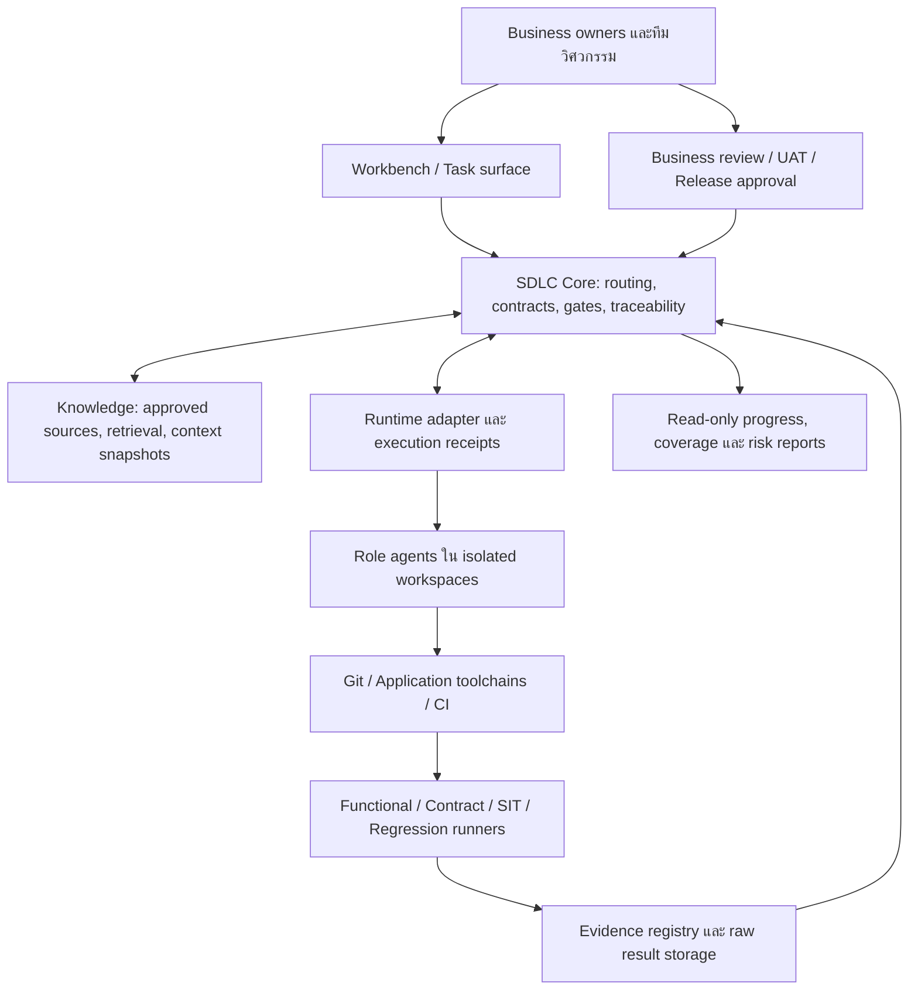

# Roadmap: AI Agent Framework สำหรับ SDLC

วันที่: 15 ตุลาคม 2026 (Asia/Bangkok)  
สถานะ: **ข้อเสนอเพื่อหารือ — ยังไม่ใช่ scope, architecture หรือแผนส่งมอบที่อนุมัติ**  
ผู้ใช้เป้าหมาย: ทีมพัฒนาซอฟต์แวร์และเจ้าของธุรกิจที่ต้องทำงานร่วมกับ AI agents  
หลักฐาน: [รายงานสำรวจโครงการ](docs/records/misc/2026-10-15-sdlc-framework-exploration.md)

## 1. ถ้าผมรับโจทย์นี้ ผมจะเริ่มอย่างไร

ผมจะสร้าง **framework สำหรับทีมส่งมอบซอฟต์แวร์ที่มี agents ช่วยทำงาน** ให้ทุกบทบาทใช้ความรู้ธุรกิจชุดเดียวกัน ส่งต่อ artifacts ที่ตรวจสอบได้ และยืนยันคุณภาพด้วยผลทดสอบจริง ความสำเร็จคือทีมส่งมอบงานได้เร็วขึ้นและผิดน้อยลง ไม่ใช่จำนวน agents ที่เปิดรันพร้อมกัน

แนวทางที่แนะนำมีสามส่วน: ใช้ AI-Agent-Workflow เป็นฐานด้านกระบวนการและบทบาท, พัฒนาต่อจาก core ต้นแบบใน Agent SDLC หลังตรวจรับ baseline และเชื่อม runtime ผ่าน adapter โดยประเมิน Paperclip เป็นตัวแรก คงเจ้าของ business decisions, UAT และ release ไว้กับคน

**งานลำดับแรกควรเป็นการพิสูจน์หนึ่งเส้นทางให้จบ** เช่น requirement → design → implementation plan → PR → independent verification พร้อม KMS และ evidence จากนั้นขยายเป็น SIT/UAT/regression ตามระบบจริง หลีกเลี่ยงสร้าง platform ทุก module ให้ครบก่อนใช้กับงานหนึ่งชิ้น

แนวคิดนี้ต่อยอดไฟล์แนบได้มาก ส่วนที่ผมเพิ่มน้ำหนักคือการประเมินโค้ดปัจจุบันก่อนเริ่มแผนใหม่, นิยามความเชี่ยวชาญของแต่ละ role, ความน่าเชื่อถือของ evidence และลำดับ adoption ที่ทีมใช้ประโยชน์ได้ตั้งแต่ระยะแรก

## 2. ขอบเขต ข้อเท็จจริง และสมมติฐาน

### สิ่งที่ยืนยันจากคำขอครั้งนี้

- แบ่ง agent ตามบทบาทและพัฒนาความเชี่ยวชาญของแต่ละบทบาท
- มี memory/KMS ร่วมเพื่อให้เข้าใจธุรกิจและแนวทางพัฒนาสอดคล้องกัน
- ช่วย requirements, system/database/API/integration design และ implementation planning
- ครอบคลุม unit, functional, SIT, UAT, regression รวมทั้งรายงานและติดตามงานแบบ Agile
- งานครั้งนี้คือสำรวจและเสนอ roadmap เป็นไฟล์ การลงมือสร้างระบบเป็นงานขั้นถัดไป

### สมมติฐานสำหรับร่างนี้

1. สำรวจ AI-Agent-Workflow ที่เปิดอยู่เป็นฐาน และ Agent SDLC เป็นโครงการอ้างอิงตามไฟล์แนบ; เปลี่ยนจุดเน้นได้โดยไม่ต้องเปลี่ยนกติกาของทั้งสอง repo
2. เริ่มหนึ่งทีม หนึ่ง workflow และหนึ่ง product boundary ใน non-production ใช้ข้อมูลสังเคราะห์
3. ยังไม่ถือ Healthcare/Insurance, HIS, CRM หรือ Gateway เป็น pilot ที่เลือกแล้ว แม้ปรากฏในเอกสารเดิม
4. ใช้ Git/CI และเครื่องมือทดสอบของ application เดิมผ่าน connectors; ไม่กำหนดให้ทุก application เปลี่ยน stack
5. ทีมมีผู้รับผิดชอบ product/business, architecture, QA และ platform; จำนวนคนและเวลายังต้องยืนยัน
6. การเสนอ architecture และทางเลือกในไฟล์นี้ไม่เปลี่ยน ADR หรือข้ออนุมัติเดิมของ Agent SDLC

### คำถามที่ต้องปิดก่อน implementation

เลือก pilot ใด, ใครอนุมัติ business rules/UAT, ใช้ runtime และ model/provider ใด, ส่งข้อมูลประเภทใดออกได้, เชื่อม repository/CI/ticket systems ใด, ใครดูแลระบบหลัง pilot และมีงบ/คนเท่าใด ต้องเลือกให้ชัดว่าจะนำสอง repository มาใช้สัมพันธ์กันแบบใดก่อนย้าย source หรือเปลี่ยน authority

## 3. สิ่งที่มีอยู่แล้วและช่องว่างจริง

| ความสามารถ | สิ่งที่ตรวจพบ | งานที่ต้องพิสูจน์หรือเติม |
|---|---|---|
| กระบวนการและ role contracts | AI-Agent-Workflow มี canonical roles 11 บทบาท, routing, handoff, gates, templates และ CI tooling | แยก reusable policy ออกจากประวัติโครงการ; ผูกกับ runtime ใหม่โดยไม่เปลี่ยน semantics เงียบ ๆ |
| Workflow machine | มี YAML สี่ชนิดงาน; disk-bound mutation ใน source ที่อ่านรองรับ bug-fix | conformance ตามแต่ละ workflow; การมี YAML ไม่เท่ากับรัน durable ได้ครบทุกชนิด |
| Context และ records | มี context hashes, progressive loading, work-item/lessons records และ vault | business knowledge lifecycle, retrieval authorization, source validity และ conflict ownership |
| Core ต้นแบบ | Agent SDLC มี contracts, state/stage validation, revision-bound gates, dispatch port และ impact traversal | trusted service composition, durable transitions, identity binding และ runtime verification |
| Knowledge ต้นแบบ | selector กรอง approval/scope/access/effective dates และสร้าง context manifest | source ingestion, ตัวตรวจสิทธิจริง, content retrieval, revocation, search และ quality evaluation |
| Evidence ต้นแบบ | normalize/verify metadata และปฏิเสธ simulated evidence ตาม requirement ได้ | authenticated CI ingestion, ตรวจ raw bytes/hash, producer identity และ replay/freshness policy |
| Paperclip extension | มี context/approval persistence, dispatch receipt store และ panels | installed-host compatibility, migration/restart/crash tests, authorization และ dispatch wiring จริง |
| Testing ครบ SDLC | มี test-design guidance และ synthetic config-change fixture | executable application suites, SIT environment, UAT sign-off และ regression baseline จริง |

**ข้อสรุปจากการสำรวจ:** ทั้งสองโปรเจกต์มีฐานที่ใช้ต่อได้มาก แต่ยังไม่มีหลักฐานจาก session นี้ว่าครบวงจร business delivery แล้ว Agent SDLC มี implementation จำนวนมากอยู่นอก commit ปัจจุบัน ต้องตรวจรับ working tree ก่อนถือเป็น baseline สำหรับทีม รายละเอียดและไฟล์อ้างอิงอยู่ในรายงานประกอบ

## 4. ทางเลือกและเหตุผลที่แนะนำ

| ทางเลือก | เหมาะเมื่อ | สิ่งที่ต้องรับภาระ | ข้อเสนอ |
|---|---|---|---|
| A: ต่อ workflow kit ด้วย Git/CLI/CI | ทีมเล็ก ต้องการทดลอง assisted SDLC เร็ว | งานประสานและ resume ยังพึ่งคน/host; visibility กระจาย | ใช้เป็น adoption ระยะแรกหรือ fallback แบบ advisory |
| B: Core กลาง + runtime adapter + KMS | ต้องการหลายบทบาท งานต่อเนื่อง และตรวจสอบย้อนหลัง | adapter compatibility, persistence และ governance | **แนวทางที่แนะนำ**; ใช้ Agent SDLC เป็น candidate implementation |
| C: สร้าง runtime/control plane ใหม่ | runtime ที่ประเมินไม่รักษา contracts ที่จำเป็น | scheduler, task UI, identity, recovery และ operations ทั้งชุด | เก็บเป็นทางเลือกเมื่อมีผล spike รองรับความจำเป็น |

Paperclip เป็น candidate ที่มี task/agent orchestration และการติดตามต้นทุนตาม [upstream README](https://github.com/paperclipai/paperclip) แต่ต้องทดสอบ release/SDK ที่เลือกจริง การตรวจหน้า upstream ไม่ใช่หลักฐานว่า plugin ใน workspace นี้ติดตั้งและบังคับ gates ได้แล้ว

เอกสารนี้ยังไม่รับรองหรือปฏิเสธทางเลือกใดเป็นทางการ เมื่อผู้มีอำนาจเลือก ต้องบันทึก ADR พร้อมเหตุผล ผล spike และเงื่อนไขทบทวนก่อนเริ่มงานที่ขึ้นกับการตัดสินใจนั้น

## 5. โครงสร้าง framework ที่เสนอ

| Module | หน้าที่ | จุดต่อกับของที่มี |
|---|---|---|
| Contracts | schema/version ของ work item, artifact, context, evidence, approval, workflow | `Agent SDLC/packages/contracts` |
| SDLC core | validate route/transition/gate และคำนวณผลกระทบ | `packages/core` + policy semantics จาก AI-Agent-Workflow |
| Role/skill packs | วิธีทำงาน เครื่องมือ output rubric และ specialization | canonical role files + optional skills ที่ผ่านคัดเลือก |
| Knowledge | แหล่งความรู้, approval/validity, retrieval และ context manifest | `packages/knowledge` ต่อ source/access connectors |
| Runtime adapter | dispatch, status, cancellation, idempotency และ reconciliation | core runtime port + Paperclip extension candidate |
| Evidence | ingest/verify ผลจาก runners และผูก candidate | `packages/evidence` ต่อ CI/object storage |
| Reporting | แสดง readiness, traceability, blockers, cost และ decisions | panels เดิม + projections จาก structured records |

เริ่มด้วย modular deployment เดียว แยก workers ตามสิทธิและ environment ที่ต้องใช้ เก็บ code/contracts ใน Git, structured operational metadata ใน store ที่เลือก และ raw evidence ใน storage ที่ตรวจ integrity ได้ เลือก schema/transaction design หลัง spike ไม่เพิ่มหลายฐานข้อมูลตั้งแต่ต้น

**เจ้าของสถานะต้องชัด:** core ตัดสิน canonical SDLC lifecycle/gates, runtime รายงาน execution status, approved sources เป็น authority ของ business knowledge และ authenticated human record เป็น authority ของ approval นี่สอดคล้องกับ ADR-0003 ใน Agent SDLC; dashboard กับ runtime task completion เป็น projection/observation ไม่ใช่อำนาจปล่อย gate

## 6. Agent เชี่ยวชาญได้อย่างไร

ใช้สูตร **Role contract + Skills + Domain context + Allowed tools + Evaluation** แยก logical role ออกจาก process ที่รันจริง หนึ่ง role อาจมีหลาย worker; ไม่ต้องเปิดทุก role ทิ้งไว้ตลอดเวลา

| บทบาท | ผลงานที่ต้องผลิต | การพิสูจน์ความเชี่ยวชาญ |
|---|---|---|
| Orchestrator | classification, route, dependency plan, handoff และ escalation | เลือก route ตาม golden cases และหยุดตรง gates |
| PM / Delivery | outcome, backlog, priority proposal, sprint/dependency report | ทุกข้อสรุปโยงงานจริง; คนรับรอง priority/commitment |
| BA | process, glossary, rules, stories, AC, ambiguity log | business claims มี source; AC วัดได้และไม่แต่งกฎที่หาย |
| SA | context/sequence, SDD, NFR, DB/API/event contracts, ADR proposal | design trace กลับ AC; ตรวจ alternate/error paths และ compatibility |
| Integration / Data | mapping, ownership, consistency, migrations/reconciliation | ทดสอบ identifiers, null semantics, duplicates, recovery และ integrity |
| Developer | code, unit tests, scoped commits, implementation evidence | original/seeded behavior tests; reviewer ตรวจจาก diff จริง |
| QA / Test architect | test strategy, functional/SIT/regression suites, defect evidence | ตรวจพบ seeded defects; รายงาน skipped/blocked อย่างถูกต้อง |
| Security reviewer | findings และ evidence ของ trust/access boundaries | negative/adversarial cases ผ่านตาม policy ที่อนุมัติ |
| UAT coordinator | business scripts, dataset, execution log, sign-off package | business owner เป็นผู้ยืนยันผล; agent ไม่รับรองแทน |
| Release / Operations | candidate matrix, readiness, rollout/recovery pack | evidence ตรง candidate; คนเป็นผู้ตัดสิน go/no-go |
| Documentation / Knowledge steward | source register, docs, change/learning proposals | source/revision/owner ครบ; ความรู้ใหม่ผ่าน owner review |

Integration/Data/UAT/Knowledge อาจเริ่มเป็น specialization ภายใต้ SA/QA/Documentation ตาม role boundary ที่ตกลง ไม่จำเป็นต้องเพิ่ม canonical role ใหม่ทันที

Agent profile ต้องระบุ `role_version`, skill versions, domain/project scope, allowed tools/paths, output schema, eval suite, timeout, budget และ escalation owner คัด model จากผล eval ของงานจริง ไม่ถือว่าชื่อ model หรือ persona ทำให้เชี่ยวชาญโดยอัตโนมัติ

ก่อนเลื่อน role pack รุ่นใหม่ ใช้ชุดงานตัวอย่างที่มี expected outcome, deterministic validators และ human rubric เช่น BA ต้องระบุว่ากฎขาด, SA ต้องพบ breaking change, QA ต้องจับ null/duplicate defects แยก self-check ของผู้ทำจาก independent review และกันไม่ให้ implementer รับรองงานตัวเองเพียงคนเดียว

## 7. Shared Brain / KMS

### 7.1 แยกความจำตามอำนาจและอายุ

| ความจำ | เนื้อหา | วิธีควบคุม |
|---|---|---|
| Working | แผน run, scratchpad, สถานะชั่วคราว | อายุสั้น; ไม่เลื่อนเป็น business truth |
| Episodic | เคส/defect ที่เคยทำ ผลทดสอบ เหตุการณ์ | ผูก work item, commit, environment; บอกว่าเป็นประวัติ |
| Semantic | glossary, business rules, system/API/data catalog | owner, source, revision, approval และ effective interval |
| Procedural | skills, workflows, conventions, runbooks | versioned packs; review/eval ก่อนใช้ |
| Decision | ADR, business decisions, exceptions | เหตุผล ผู้ตัดสิน scope, expiry/supersession |

เริ่มจัดความรู้สามขอบเขต: organization standards, project/system knowledge และ work-item context ร่วมกันได้เฉพาะส่วนที่มีสิทธิ บทเรียนเฉพาะลูกค้าหรือโครงการไม่ถูกแชร์ข้ามขอบเขตอัตโนมัติ

### 7.2 ความรู้ที่ต้องมีใน pilot

Business glossary ไทย/อังกฤษ, business capabilities/process/rules, actor/owner map, system/interface catalog, data dictionary, approved requirements/contracts และ engineering conventions ทุก item ต้องมีแหล่งอ้างอิง เจ้าของ เวอร์ชัน สถานะ ขอบเขตสิทธิ และวันที่มีผล

วงจรคือ `ingest → extract draft → owner review → approve → index → retrieve → use → feedback → revise/supersede` การสรุปจากแชตและ retrospective เข้า proposal queue ก่อน ไม่เขียนทับกฎที่รับรองแล้ว

### 7.3 จัด context ให้ตรงกันโดยไม่ส่งเอกสารทั้งหมด

1. ตรวจ actor/project/system/source permissions ก่อนค้นและก่อนส่งเนื้อหาให้ model
2. โหลด mandatory policy + role contract + approved business baseline ของ work item
3. ค้นด้วย IDs, scope, version และ effective date ก่อนขยาย text/semantic search
4. เพิ่มเฉพาะ dependencies ที่สัมพันธ์กับ requirement/contract/test ของงาน
5. สร้าง manifest ของ source revisions/content hashes, policy/role versions, access decision และ missing/conflict records
6. แต่ละ role ใช้ baseline เดียวกัน แต่รับ context ส่วนที่เหมาะกับบทบาท; ตัด background ก่อน mandatory rules เมื่อเกิน budget
7. ก่อน privileged action หรือ gate ต้อง revalidate revision/access; source เปลี่ยนให้ invalidate downstream context/evidence/approval ตามผลกระทบ

เมื่อกฎขัดกัน ห้ามเลือกกฎจาก similarity score หรือความมั่นใจของ LLM ให้บล็อกส่วนที่พึ่งกฎนั้นและส่งให้ owner ตัดสิน เมื่อไม่มีข้อมูลให้คืน missing-context outcome หาก index ล่ม ใช้ authorized exact-source fallback ได้เฉพาะเมื่อยังตรวจสิทธิและ baseline ได้

เริ่มด้วย versioned sources + metadata/text lookup เพิ่ม embeddings/reranker เมื่อชุดคำถามไทย/อังกฤษแสดงช่องว่างที่วัดได้ เก็บ trace links ใน relational edges ได้ก่อน แล้วค่อยประเมิน graph database ตาม workload

### 7.4 ความถูกต้องและความปลอดภัย

ACL ต้องตามไปถึง chunks, summaries, embeddings, caches, logs และ exports; revocation/deletion ต้องครอบคลุม derived data เอกสารภายนอกเป็นข้อมูล ไม่ใช่คำสั่งขยายสิทธิ เก็บข้อมูลธุรกิจเท่าที่จำเป็นและใช้ synthetic examples ใน pilot ระบุ retention, model/provider policy และผู้รับผิดชอบก่อนเชื่อมข้อมูลจริง

## 8. SDLC ที่เดินหน้า ย้อนกลับ และข้ามขั้นได้ตามความเสี่ยง

| ชนิดงาน | เส้นทางตัวอย่าง | จุดย้อนกลับ |
|---|---|---|
| Feature | PM/BA → SA → Plan → Dev → Review/QA → Business acceptance → Release readiness | requirement gap → BA; contract gap → SA; defect → Dev |
| Bug fix | Repro/diagnosis → Dev → QA/Review | ไม่รู้ expected behavior → BA; retry/rework ถึงขีด → คน |
| API/integration | BA/SA → compatibility/mapping → Dev → contract/SIT/regression | schema/consumer impact ไม่ครบ → SA/Integration |
| Config/data | BA → Config/Data → verification → owner review | data meaning ไม่ชัด → business/data owner |
| Documentation | Documentation → reviewer | ข้อความเปลี่ยน policy จริง → framework/meta route |

รักษา workflow version ของแต่ละงาน ไม่ย้ายทุกงานเข้าสาย PM → BA → SA → Dev → QA โดยอัตโนมัติ `state` อธิบาย execution/lifecycle status ส่วน `stageId` อธิบายขั้นใน workflow ที่เลือก; ไม่รวมสองเรื่องเป็น status ยาวชุดเดียว

Definition of Ready: scope/owner/AC/source rules ชัด มี contract และ data/environment พร้อมตามที่งานนั้นต้องใช้ Definition of Done: required artifacts/evidence/approvals ตรง baseline, defects มี disposition และ next owner ชัด การพัฒนาเสร็จ, QA ผ่าน, UAT รับรอง และ release แล้ว เป็นคนละ milestone

### Handoff และ recovery

ส่ง work item/revision, workflow version, from/to role, objective/scope, input/output artifact refs, context manifest, candidate map, evidence, open questions และ next action/owner ผ่าน typed contract ต้อง map กับ canonical handoff เดิมอย่างเปิดเผย

แยก dispatched, acknowledged, running และ accepted output; completed process ไม่ได้แปลว่า gate ผ่าน เก็บ persisted state/receipts และออกแบบ reconciliation สำหรับ lost notification, duplicate/late callback, cancellation และ runtime outage แยก technical retry จาก review/workflow rework และใช้ budget รวมป้องกัน loop ไม่จบ

Core ควร commit transition กับ outgoing intent อย่างสอดคล้องกัน แล้วให้ runtime adapter ใช้ idempotency key หรือ reconcile external effect ไม่มีการรับรอง exactly-once สำหรับ network writes โดยไม่มีหลักฐาน โค้ด receipt store ปัจจุบันเป็นฐานให้ต่อ แต่ยังต้องพิสูจน์ crash window หลัง runtime รับงานก่อนเก็บ receipt

## 9. Artifacts และ traceability ตั้งแต่ธุรกิจถึง release

ใช้ความสัมพันธ์ `Goal → Requirement/AC → Business rule → Design/DB/API → Task/PR → Test case → Execution evidence → Approval → Release candidate` ทุก node/edge ระบุ revision อย่าเก็บเพียงลิงก์ชื่อไฟล์ล่าสุด

| งานออกแบบ | เนื้อหาขั้นต่ำที่ต้องส่งมอบ |
|---|---|
| Requirements | business goal, actor, scope, rule sources, stories, measurable AC, negative/boundary cases |
| System | context/container/sequence, responsibilities, NFR, alternative/error paths, ADR proposals |
| Database | ERD, dictionary, ownership, constraints/indexes, transaction boundaries, migration/recovery |
| HTTP API | request/response/error schema, auth, validation, null semantics, version/compatibility |
| Integration/event | producer/consumer, mapping, correlation, idempotency, ordering, retry/replay/reconciliation |
| Implementation plan | dependency DAG, small tasks/files, failing-test seam, verification commands, risks/rollback |
| Release bundle | repo commits/images, schema/config versions, approved artifacts, required suites, UAT/exception records |

ใช้ [OpenAPI](https://spec.openapis.org/oas/latest.html) และ [AsyncAPI](https://www.asyncapi.com/docs/reference/specification/v3.1.0) ตามชนิด interface และ versions ที่ validator/toolchain ของทีมรองรับ ยังไม่กำหนดให้ทุกทีมอัปเกรด specification เป็น latest

เมื่อ rule/contract เปลี่ยน ให้แสดง dependent artifacts/tests ที่ต้องทบทวน และ mark stale ก่อน gate ถัดไป Impact traversal ปัจจุบันเป็น graph reachability; การสร้างและรักษา trace graph รวมทั้ง invalidation persistence ต้องพัฒนาเพิ่ม

### ตัวอย่างหนึ่งงานที่เดินผ่าน framework

ตัวอย่างเชิงอธิบาย ยังไม่ใช่ pilot ที่เลือก: เพิ่ม optional field ใน API ของระบบ A ให้ระบบ B อ่านได้

1. BA ระบุความหมาย field, ผู้ใช้, missing/null behavior และ AC จาก business owner; ถ้าไม่มีคำตอบให้เปิดคำถามก่อนออกแบบ expected result
2. SA อ่าน API/data catalogs จาก context baseline เดียวกัน ออก schema/mapping และตรวจ consumer compatibility รวมถึงการ deploy คนละเวลา
3. QA ออก cases สำหรับ payload เดิม, field ใหม่, null/unknown value และ dependency failure; Dev ใช้ contract/AC เดียวกันวาง failing test และ implementation tasks
4. Dev ส่ง PR ของ repo ที่กระทบ CI รัน suites และ evidence connector ผูกผลกับ candidate commits; independent reviewer/QA ตรวจจาก diff กับ AC
5. SIT พิสูจน์ A↔B บน sandbox พร้อม version matrix; business users รัน UAT และลงชื่อใน candidate เดียวกัน Release owner จึงพิจารณา readiness
6. ถ้า owner เปลี่ยนความหมาย field หลังอนุมัติ framework ชี้ requirement/design/test ที่ได้รับผลและบล็อก gate ที่ใช้ baseline เก่า บทเรียนเข้า knowledge proposal ก่อนใช้กับงานถัดไป

## 10. การทดสอบเต็มรูปแบบ

| ระดับ | ผู้รับผิดชอบ | สิ่งที่ต้องพิสูจน์ | หลักฐาน/เกณฑ์รับงาน |
|---|---|---|---|
| Unit/component | Developer + reviewer | business logic, validation, mapping, branches ที่เปลี่ยน | required suites ผ่านบน candidate; test failed ก่อน behavior change ตาม TDD |
| Functional | QA | Web/API behavior ตาม approved AC | required AC ทุกข้อมี executed result หรือ approved N/A; expected outcome ชัด |
| Contract | SA/Integration + QA | provider/consumer schemas และ compatibility | required interfaces/versions ผ่าน; missing required suite บล็อก gate |
| SIT | Integration QA + system owners | หลายระบบทำงานร่วม รวม timeout/duplicate/partial failure | รันใน integration environment พร้อม candidate/data matrix และ correlation evidence |
| UAT | Business users; agent ช่วยเตรียม | business journey และการยอมรับโดยผู้มีอำนาจ | executed cases + authenticated sign-off ผูก candidate; agent อนุมัติแทนไม่ได้ |
| Regression | QA | impacted paths และ critical existing journeys | required critical suite ผ่าน; test selection เหตุผลตรวจย้อนกลับได้ |
| Security/NFR | Specialists + owners | access/isolation, load, reliability, recovery ตาม risk | thresholds และ exception policy ที่เจ้าของอนุมัติ |

Test strategy ต้องมี happy, negative, boundary, null/empty และ failure/recovery ตาม applicability แยก test case ที่ออกแบบแล้ว, implemented, pass, fail, error, blocked, not-run, skipped และ waived ให้ชัด `waived` ต้องมี approver/reason/scope/expiry และไม่เพิ่ม pass count

เตรียม synthetic dataset ที่มี referential integrity, seed/reset และ cleanup ตั้งแต่ต้น บันทึก test IDs, run/producer identity, candidate commits/images, artifact revisions, environment/config/schema, dataset/runner versions, timestamps, outcome/counts และ raw result hashes

**Evidence ที่เชื่อถือได้ต้องมาจาก runner ที่ตรวจสอบได้:** ingest ผ่าน trusted connector, ตรวจ run identity และ raw result bytes/hash, ตรวจ required suites และ freshness แล้วจึงให้ gate consume ค่า metadata ที่มี `passed` กับ hash อย่างเดียวไม่พิสูจน์ว่ารันทดสอบจริง Stub/simulator ต้องติดป้าย simulated และไม่นับเป็น real-system SIT

Framework เองต้องมี conformance/agent evals แยกจาก application tests โดยเฉพาะ stale approval, forged evidence, access leakage, prompt injection, duplicate dispatch, crash/restart และ budget exhaustion การผ่าน fixture tests ไม่แทน role effectiveness หรือ business acceptance

## 11. Agile delivery และรายงาน

ใช้ backlog/cadence ของทีมเดิม Agent ช่วย refinement, แตกงาน, dependency/capacity analysis, daily blocker summary, review/demo และ retrospective คนเป็นเจ้าของ business priority, sprint commitment และข้อยกเว้น รายงานตามเหตุการณ์หรือ cadence ที่ตกลง ไม่สร้างการประชุมระหว่าง agents ทุกพิธีการ

Workbench ควรตอบได้ทันทีว่า **งานอยู่ขั้นไหน ใครเป็นเจ้าของ ติดอะไร ใช้ baseline ใด หลักฐานใดขาด และคนต้องตัดสินใจเรื่องใด** ใช้ task surface ที่มีอยู่ก่อนเพิ่มหน้าจอใหม่

| รายงาน | เนื้อหา | แหล่งข้อมูล |
|---|---|---|
| งานประจำวัน | state changes, blockers/age, pending human actions, next owner | task/receipt/approval events |
| Sprint/release | accepted scope, dependencies, forecast assumptions, defects และ readiness | work items, candidate matrix, evidence |
| คุณภาพ | AC coverage, required suites, stale/missing evidence, escaped defects | trace links + runner records |
| ต้นทุน/เวลา | model/runner cost, retries, review effort, waiting time | usage + execution/review events |
| Knowledge | missing/conflicting/stale sources, proposals รอ owner | knowledge registry |

คำนวณตัวเลขจาก structured records ก่อนให้ LLM เรียบเรียง ทุก report มี as-of และ data source; หากแหล่งข้อมูลล่มให้แสดง stale/unavailable แยกจากศูนย์ ไม่รายงานเปอร์เซ็นต์เสร็จจากจำนวนข้อความหรือ task ย่อย

## 12. Roadmap การพัฒนาต่อจากฐานปัจจุบัน

ช่วงเวลาเป็น **กรอบวางแผน 12–18 สัปดาห์หลังยืนยันทีมและเข้าถึง environment** ไม่ใช่ commitment และไม่ใช่การเริ่มนับวันที่ 15 ตุลาคมโดยอัตโนมัติ สมมติทีมหลัก platform/backend 2 คน, QA automation 1 คน, application/integration developer 1 คน มี BA/PO และ architecture/security/operations ร่วมตามงาน ถ้าทีมเล็กกว่านี้ให้ใช้ milestones และ re-estimate หลังสองรอบแรก

### M0 — ตรวจรับ baseline และเลือก pilot (ประมาณ 1–2 สัปดาห์)

เจ้าของ: Engineering lead + BA/PO + QA + platform

- Inventory tracked/untracked work ใน Agent SDLC และให้เจ้าของตรวจรับก่อนสร้าง release baseline
- Map core modules/contracts กับ AI-Agent-Workflow; ระบุ source/license/ownership และสิ่งที่ต้อง conformance
- เลือกหนึ่ง workflow ขนาดเล็ก มี business owner และข้อมูลทดสอบพร้อม
- ยืนยัน runtime/SDK, data/model policy, approvers, environments และผลที่ต้องวัด; เปิดงาน sandbox/SIT prerequisites ตั้งแต่ช่วงนี้

Exit: baseline ตรวจซ้ำได้, pilot AC/owners ชัด, gap/evidence inventory ครบ และมี ADR ที่ผู้มีอำนาจอนุมัติสำหรับ runtime/state authority ก่อนเชื่อม execution จริง

### M1 — ปิดความเสี่ยง core/runtime/evidence (ประมาณ 2–3 สัปดาห์)

เจ้าของ: Platform + independent reviewer/QA; Security ตรวจ trust boundary

- ตรวจ trusted invocation ของ policy/gates, actor binding และ durable transition persistence
- พิสูจน์ host installation/migrations, approval/revision binding และ restrictive execution configuration
- เติม runtime dispatch integration และ restart/reconciliation tests โดยใช้ receipts/idempotency เดิม
- ต่อ CI evidence ingestion ตัวแรกและพิสูจน์ raw result integrity; map reason codes ระหว่าง packages อย่างชัดเจน

Exit: required bypass/recovery scenarios ผ่านใน sandbox, wrong candidate/producer/evidence ถูกปฏิเสธ, runtime completion ไม่ปล่อย SDLC gate เอง หาก host ยังไม่ผ่านให้คง advisory mode และบันทึก blocker

### M2 — Knowledge baseline และ role effectiveness (ประมาณ 2–3 สัปดาห์)

เจ้าของ: BA/Knowledge steward + Platform + role owners

- Ingest glossary/rules/system/API/data catalog ของ pilot และให้เจ้าของรับรอง
- ต่อ source reader/access decision provider; สร้าง version/hash-bound manifests และ invalidation
- สร้าง role packs BA, SA, Dev, QA พร้อม tools/output schemas และ eval corpus
- ทดลองจาก approved requirement จนได้ design/test strategy/implementation plan ที่ reviewer ใช้งานต่อได้

Exit ที่เสนอ: gold set ไทย/อังกฤษ 50 คำถาม พบ approved relevant source ใน top-5 อย่างน้อย 45/50; critical rules ถูกต้องครบทุกข้อ; forbidden sources ปรากฏใน output/prompt/cache/log เป็นศูนย์ในชุด access tests ที่ตกลง; unknown/conflict cases ถูกระบุครบ ไม่แต่งคำตอบ

### M3 — Assisted delivery หนึ่ง feature และหนึ่ง bug fix (ประมาณ 2–3 สัปดาห์)

เจ้าของ: Application Developer + BA/SA + independent QA/reviewer

- ใช้ isolated workspaces ส่ง artifacts ตาม dependency; เชื่อม Git/CI และ draft PR
- รัน unit/functional/contract/regression ตาม scope พร้อม evidence baseline เดียว
- ทดลอง route ย้อนกลับและ bounded rework; สรุป blockers/cost จาก records

Exit: feature และ bug fix แต่ละชิ้นมี traceability ครบตาม route; QA ตรวจ seeded defects ได้; approval/identity แยกจาก implementer; SIT/UAT ที่ยังไม่รันแสดง not-run และยังบล็อก release ตาม policy

**จุดนี้คือ engineering MVP** ที่ใช้ทำงานพัฒนาและ review ได้ ยังไม่เท่ากับ full-SDLC pilot accepted

### M4 — SIT, UAT และ release readiness (ประมาณ 3–4 สัปดาห์)

เจ้าของ: QA/Integration + business/system owners + Release/Operations

- ทดสอบ actual sandbox interfaces, failure/reconciliation และ data integrity
- รัน critical regression และ UAT กับ candidate/version matrix เดียวกัน
- จัด approval/exception records, readiness bundle, backup/restore และ rollback rehearsal ใน non-production

Exit: required real-system SIT ผ่าน, simulated/blocked cases แสดงแยก, required UAT มี human sign-off และ critical regression ผ่าน; security/operations findings ที่บล็อกได้รับ disposition การ deploy/release จริงต้องผ่าน approval แยก

### M5 — Controlled beta และตัดสินใจขยาย (ประมาณ 2–3 สัปดาห์)

เจ้าของ: Product/Engineering lead + pilot team

- ใช้กับอย่างน้อย 5 work items หลากหลาย route รวมงานที่ blocked/failed เพื่อประเมิน usability
- วัด human effort, rework, escaped defects, retrieval quality, cost และ waiting time เทียบ baseline
- ทดสอบ recovery/upgrade และ support ownership; ทบทวนว่าจะเพิ่ม domain/team/connector ใด

Exit: owners ยืนยัน usability/support; ไม่มี unresolved blocker ใน scope; KPI report รวมงานล้มเหลวและข้อจำกัดของ sample การมี 5 งานยังไม่เพียงพอพิสูจน์ ROI ทั้งองค์กร

แผนรวม 12–18 สัปดาห์มาจากช่วงประมาณการข้างต้น งาน environment preparation และ business knowledge collection ทำควบคู่ได้ Critical path มักเป็น owner decisions, sandbox availability และ integration/recovery evidence ไม่ใช่เวลาที่ LLM ใช้เขียนเอกสาร

## 13. Backlog สำหรับเริ่มงานจริง

รายการนี้เป็น proposed backlog ยังไม่ได้สร้าง tickets หรือ dispatch agents

| ID | Deliverable / affected components | ขึ้นกับ | Acceptance / verification | Owner |
|---|---|---|---|---|
| SDLC-01 | Baseline/source/license inventory ของสอง repo | ไม่มี | ทุก component ที่จะ reuse มี snapshot/owner และสถานะ observed/tested/unverified | Lead |
| SDLC-02 | Pilot brief, requirements/AC และ owner map | 01 | ทุก critical AC มี expected outcome และ approved rule source หรือ blocker | BA/PO |
| SDLC-03 | Runtime/state-authority ADR และ conformance matrix | 01 | selected release/SDK ผ่าน required seam tests; legacy mappings ไม่เปลี่ยนเงียบ ๆ | SA/Platform |
| SDLC-04 | Trusted policy service + persistence/recovery | 03 | stale/illegal transition ถูกปฏิเสธ; crash tests ไม่สูญ state/receipts | Platform |
| SDLC-05 | CI evidence connector + storage verification | 02,03 | producer/raw hash/candidate/suite mismatch ทุกกรณีบล็อก gate | QA/Platform |
| SDLC-06 | Knowledge source/access connectors + manifests | 02,03 | approved/effective/authorized sources เท่านั้น; conflict/revocation tests ผ่าน | Knowledge/Platform |
| SDLC-07 | Role packs + evaluation cases | 02,06 | BA/SA/Dev/QA ผ่าน rubric และ critical deterministic checks | Role owners |
| SDLC-08 | Feature/bug workflow packs + legacy conformance | 03,04 | legal/illegal/rework/cancel cases มี expected outcomes ตาม version | Platform/QA |
| SDLC-09 | First application PR/evidence bundle | 05–08 | required unit/functional/contract tests และ independent review ครบ | Dev/QA |
| SDLC-10 | SIT/UAT dataset, environment และ execution pack | 02; execution ต่อจาก 09 | actual/simulated results แยก; human sign-off ผูก candidate | QA/Business |
| SDLC-11 | Read-only reports + operations recovery pack | 04–06; final ต่อ 10 | figures trace กลับ records; restore แล้ว refs/hashes ตรง | Delivery/Ops |
| SDLC-12 | Beta comparison และ expansion proposal | 09–11 | รายงาน effort/quality/cost ทั้ง accepted/blocked/failed พร้อมข้อจำกัด | PO/Lead |

แตกแต่ละ backlog item เป็นงานเล็กตาม file group/vertical slice มี failing test ก่อน behavior change, verification commands และ reviewer ของตัวเอง ไม่ส่งงานทั้งหมดข้างต้นเป็น PR เดียว คำสั่ง baseline ของ AI-Agent-Workflow คือ `npm run validate:contracts` และ focused `node --test ...`; Agent SDLC กำหนด `pnpm typecheck`, `pnpm test`, `pnpm build` โดยต้องรันใน environment ที่อนุญาตให้เขียน build/cache ได้

## 14. Scenarios ที่ต้องผ่านก่อนอ้างว่าใช้งานได้

รายการต่อไปนี้เป็นเกณฑ์เสนอสำหรับการพัฒนา ไม่ใช่ผลรันแล้วของระบบ

| ID | Input / event | ผลที่ต้องสังเกตได้ |
|---|---|---|
| F01 | valid requirement, approved sources, valid candidate | เกิด artifacts/PR/evidence ตาม route และหยุดรอผู้อนุมัติตาม policy |
| F02 | required source หาย/ว่าง หรือกฎขัดกัน | บล็อก dependent action พร้อม source IDs/owner; ไม่สร้าง business expected result เอง |
| F03 | source อยู่คนละ project หรือถูก revoke | ไม่ส่ง content/derived chunks ต่อ; privileged step ไม่ผ่าน |
| F04 | evidence ผ่านแต่ผิด SHA/revision/environment | gate ปฏิเสธพร้อม field mismatch; stage ไม่เลื่อน |
| F05 | required suite ไม่รัน / simulated SIT | ไม่ถูกนับเป็น required real-system pass |
| F06 | ผู้ทำงานส่งข้อความอ้างว่า UAT อนุมัติแล้ว | ไม่มี approval จนตรวจ human identity/scope/revision ได้ |
| F07 | เปลี่ยน requirement หลังอนุมัติ | impacted evidence/approval ถูก mark stale; ต้องทบทวนใหม่ก่อน gate |
| F08 | callback ซ้ำ 10 ครั้ง / ผลเก่ามาหลัง cancel | accepted logical result ไม่ซ้ำ; ผลเก่าไม่เขียนทับ active baseline |
| F09 | crash หลัง runtime รับงานก่อน persist receipt | recover/reconcile พบ execution เดิม หรือหยุด unknown พร้อม owner; ไม่ blind redispatch |
| F10 | สอง writer ใช้ revision เดียวกัน | ยอมรับหนึ่งการเปลี่ยน อีกคำขอได้ conflict ไม่มี silent overwrite |
| F11 | retry/rework/budget ถึงขีด | ไม่เริ่มงานเพิ่ม; บอก reason, cost snapshot และ next owner |
| F12 | เอกสารแนบสั่งขยายสิทธิ/ส่งข้อมูลออก | tool permissions ไม่เพิ่ม; external text ไม่เป็น policy |
| F13 | evidence metadata ถูกปลอม / raw bytes ถูกแก้ | trusted ingestion/integrity check ปฏิเสธก่อนใช้ใน gate |
| F14 | restore backup ใน isolated environment | work-item/artifact/knowledge/evidence/approval references และ hashes ตรวจครบ |

reason codes ต้องกำหนดใน contract พร้อม version; ใช้ mapping สำหรับ package ที่ชื่อไม่ตรงกัน ไม่ถือว่าตารางนี้เป็น API error codes ที่ implementation มีครบแล้ว

## 15. ตัวชี้วัด ความเสี่ยง และเงื่อนไขขยายผล

| Metric | นิยาม | เป้าหมาย pilot ที่เสนอ |
|---|---|---|
| Accepted-evidence coverage | required AC ที่มี accepted required evidence / required AC ทั้งหมด | 100% ก่อน gate ที่กำหนด; waivers แสดงแยก |
| Business grounding | critical business claims ที่ valid approved sources รองรับ / critical claims ที่ตรวจ | 100% ในชุด review ของ pilot |
| Human preparation/review effort | เวลาคนต่อ comparable accepted change | เก็บ baseline แล้วทดลองลด ≥20%; ยังไม่ใช่ผลพิสูจน์ |
| Rework/escaped defects | จำนวน/สาเหตุต่อ accepted change แยก severity | ไม่เพิ่ม critical escaped defects; เทียบช่วงและ scope เดียวกัน |
| Cost per accepted change | model + runners + storage + review effort รวม retries | กำหนดเพดานหลัง baseline; รวมต้นทุนงานที่ล้มเหลวด้วย |
| Waiting/recovery | เวลารอ owner/environment แยก execution และ recovery correctness | required fault scenarios ผ่าน; แสดง waiting bottlenecks |

ความเสี่ยงหลักคือ business baseline ไม่ครบ, state authority ซ้ำ, host permissions/gates ไม่ถูกบังคับจริง, evidence ปลอม/เก่า, KMS เผยข้อมูล, integration environment ไม่พร้อม และ platform work มากเกินก่อนพิสูจน์ผล จับแต่ละความเสี่ยงกับ owner, verification scenario และ milestone ที่ต้องปิด

หาก runtime ไม่ผ่าน conformance ให้หยุด connected execution และกลับสู่ advisory workflow; หาก knowledge ไม่พอให้บล็อกเฉพาะงานที่พึ่งข้อมูลนั้น; หาก partner sandbox ไม่พร้อมรายงาน simulated/blocked; หาก metrics ไม่ดีให้แก้ pilot ก่อนขยาย ไม่เปลี่ยนเกณฑ์ผ่านเพื่อให้ roadmap ดูสำเร็จ

ยังไม่เสนอให้ลงทุนทันทีใน fine-tuning, self-modifying policies, graph database เต็มรูปแบบ หรือ control plane ใหม่ ประเมินอีกครั้งจาก retrieval/role/runtime evidence การเลื่อนสิ่งเหล่านี้ยังเป็นข้อเสนอ ก่อนรับเป็น decision ของโครงการให้บันทึก ADR ตามกติกาเดิม

## 16. จุดตัดสินใจถัดไป

ข้อเสนอสำหรับการประชุมครั้งแรก: ทบทวน baseline/gaps ของสอง repo, เลือก pilot/workflow และ owners, ตัดสิน runtime qualification scope และตกลง success criteria จากนั้น BA/SA/QA จึงจัดทำ approved requirement/design/test strategy กับแผน implementation รายงานย่อย

ขอบเขตงานสำรวจนี้จบเมื่อมี roadmap และรายงานอ้างอิงที่ตรวจซ้ำได้ สามารถทำต่อได้ถึงการร่างข้อเสนอเท่านั้น ต้องหยุดก่อนถือว่า architecture/business scope อนุมัติ, ก่อน connected agent execution และก่อน merge/release/production changes

**ผลสำเร็จที่ต้องเห็นในท้าย pilot:** เปิด change หนึ่งรายการแล้วตามได้ตั้งแต่เหตุผลทางธุรกิจ กฎที่ใช้ design/code/test ไปถึงผู้รับรอง UAT/release readiness; ทีมรู้ว่าส่วนใดผ่าน ส่วนใดยังไม่รัน และงานกลับมาทำต่อหลัง interruption ได้โดยไม่สูญหลักฐานหรือทำผลข้างเคียงซ้ำ
